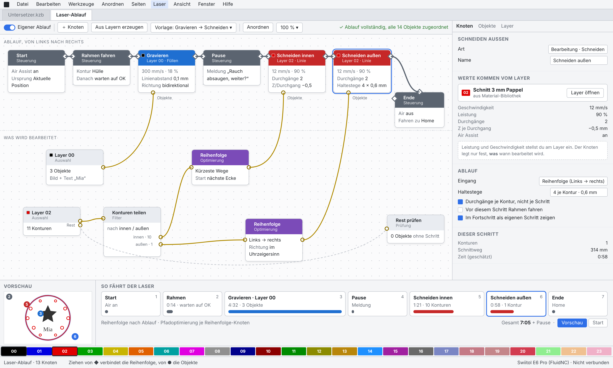

# Job graph: node-based job order (proposal)

Status: **implemented on branch `claude/project-thread-j16p78` for testing (#551).** This page describes a node-based way to set the order in which the laser
works through a job, and which settings each step uses. It is a design basis for discussion before any code is
written.

## Problem

Today the job order is implicit. `src/gcode.ts` builds it from fixed rules:

1. layers sorted by `priority`,
2. within a layer, the layer itself and then its enabled sub-layers,
3. per entry, all of its passes,
4. path optimization (`OrderOpts`: inner first, shortest travel, group, direction, best start, …), set per device
   and overridable per job (`OrderOverride`).

That works, but users can't see or easily change the order. Common wishes need workarounds today: "engrave, pause
so I can check, then cut inner holes before the outline", "cut left to right, but only for the outlines", "frame
before this step only".

## Idea

A **Laser job** window shows the job as a graph that the user can rewire:

- **Sequence chain (◆ ports):** the steps in the order the laser runs them, left to right.
- **Selection nodes (● ports):** decide *what* a step works on: a layer, a color, inner or outer contours, a group,
  a page. Filters split a set (for example inner/outer).
- **Operation nodes:** engrave, fill or cut a selection.
- **Order nodes:** path optimization for one selection (shortest travel, left to right, inner before outer, start
  corner, direction).
- **Control nodes:** start, run frame, pause with a message, air assist on/off, Z step, repeat n times, custom
  G-code, end (go home).
- **Check node:** lists objects that no step uses, so nothing is silently left out.

The bottom strip ("How the laser runs") lists the resulting steps with estimated time per step and in total, and a
small preview marks where each step lies on the workpiece.

## Layer settings and overrides

By default an operation node **points to a layer and uses its cut settings**. The layer remains the normal source
of speed, power, passes and so on, and the node inspector shows those values with a button to open the layer.

A node may **override individual settings** for its step (for example power or passes). Overrides are allowed and
deliberate, but always visible:

- The inspector shows the overridden value next to the layer value ("85 % · layer: 90 %"), with a reset button.
- The node gets a small badge, and the inspector a short notice: "This step overrides layer settings".
- Before a job starts, the job summary lists the steps with overrides, so a changed material preset can't be
  silently ignored.

Settings that are about flow are always node settings: tabs for this step, "run frame before this step", "passes
per contour vs. per step", show as its own step in progress.

## Custom G-code

The graph can also change the G-code itself:

- **G-code node** in the sequence chain: inserts the user's lines at that point (for example `G4 P5` to let the
  material cool, or switching an extra output).
- **Before/after G-code** on an operation node: lines that run around one step.
- **Replace laser on/off** for one step (the firmware profile's `laserOn` lines), for machines that need special
  commands.

Because custom G-code can bypass layer and device settings, a node with custom G-code shows the same notice as an
override. Safety rules stay in force: the lines are checked against the firmware profile (no homing, no unit or
coordinate-mode changes without restoring them, no `M3`/`M4` power above the device limit), the preview and
estimate treat unknown lines as zero-time, and the G-code view marks each line with its node as origin
(`GCodeOrigin` gets a `node` value). Agent (MCP) jobs keep their power and speed limits and can't add custom G-code
without the user's confirmation.

## Architecture

- **Data model:** `Doc.jobGraph` (optional) with nodes, typed ports and edges, saved in the project file and in
  undo history.
- **Compiler:** turns the graph into the list of entries that the G-code build already processes (layer/sub-layer
  entries with passes and `OrderOpts`, with per-step overrides applied to a copy of the layer settings) plus
  control and custom G-code inserts. Path generation stays unchanged.
- **Default graph:** without a custom graph, the app derives one from the layers. With no custom graph the output
  must be **byte-identical** to today's, checked by tests.
- **Estimate and preview** follow the compiled order, so time per step comes from the existing estimator.
- **MCP:** a command to read and set the job graph, with the same machine rules as other agent commands.
- **UI:** a dockable window opened from the Laser menu. Native DOM like the rest of the app, no new framework.

## Stages

1. Data model, compiler and default graph from layers, view only. Tests prove identical output.
2. Editable graph: selection, filter, order and operation nodes; check node.
3. Control nodes (frame, pause, air, Z, repeat), per-step overrides with notice, per-step estimate and preview.
4. Custom G-code nodes and before/after G-code with checks, MCP command, saved graph templates.

## Risks and open questions

- Two views of the same thing (layer table and graph) must never disagree. Overrides make this harder, hence the
  badge, the notice and the list before the job starts.
- Custom G-code is machine control. It needs the checks above and tests in the Virtual Machine before release.
- Pause support differs by firmware. Whether `M0` pauses on FluidNC needs a hardware test; firmware without it gets
  a warning or no pause node.
- `.lbrn2` import has to map cleanly onto the default graph.
- Node editors can scare beginners. The window stays optional and ships ready-made graphs.
